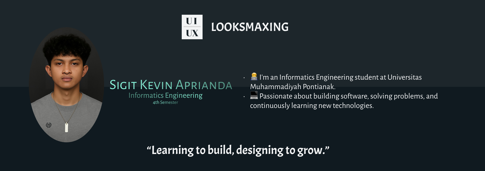

<h1 align="center">Hi 👋, I'm Sigit Kevin Aprianda</h1>

  <b>Full Stack Developer in Training</b> | Ketapang, West Kalimantan, Indonesia

  

---

### 🛠️ Tech Stack

<strong>Programming:</strong> Java, PHP, JavaScript, TypeScript (learning)  
<strong>Web:</strong> HTML5, CSS3, ReactJS (learning), Node.js (learning)  
<strong>Database:</strong> MySQL  
<strong>Tools:</strong> Git, VS Code, IntelliJ IDEA, Figma, XAMPP, Terminal  

  

---

### 📖 Currently Learning
- ReactJS & Node.js (Full Stack path)
- Laravel & RESTful APIs
- Backend Development
- UI/UX Design with Figma

---

### 💼 Featured Projects

| Project | Description | Stack | Link |
|---------|-------------|-------|------|
| [Sistem Inventaris Toko] | Aplikasi manajemen stok barang untuk toko kecil dengan fitur CRUD, tracking stok minimum, dan laporan barang yang hampir habis. | Java, MySQL | [Repo](#) |
| [E-Commerce Sederhana] | Toko online sederhana dengan katalog produk, keranjang belanja, dan halaman admin untuk mengelola pesanan. | PHP, MySQL | [Repo](#) |
| [Task Manager Full Stack] | Aplikasi manajemen tugas dengan board To Do / Doing / Done, autentikasi user, dan REST API untuk komunikasi frontend dan backend. | React, Node.js, MySQL | [Repo](#) |

---

### 🤝 Ask Me About
- Martial Arts & discipline
- Culture of Ketapang, West Kalimantan
- Transitioning from student to junior developer

---

### 📫 Connect with Me

  
  

---

  
  

  <i>"What makes us more proficient are the requests of the clients."</i>

